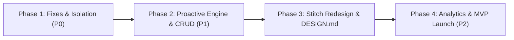

# ⚡ Proactive 31-Day Habit Tracker — State Analysis & MVP Roadmap

## 1. Executive Summary & Current State Analysis

The **Proactive 31-Day Habit Tracker** is a full-stack TypeScript monorepo (`backend/` with Express 5, Prisma 6, PostgreSQL; `frontend/` with React 19, Vite 8, Tailwind CSS v4, Zustand, React Router v7). Its core differentiator is **proactive discipline**: rather than passively logging habits, users commit to a 31-day sprint across **8 Core Pillars** (*Learning, Physical Health, Nutrition, Mindfulness, Work / Focus, Finance, Organization, Rest*) and must plan tomorrow's specific actions before closing today.

### 🌿 Branch & Issue Landscape
| Branch / Issue | Status | Findings |
| :--- | :--- | :--- |
| `main` (`057527a`) | Active Default | Contains JWT Auth (`User` model, `/api/auth/*`, Zustand store) and Neon serverless adapter, but **multi-tenant `userId` filtering is missing in most queries**. |
| `origin/dev` (`e950438` / PR #10) | Ahead of `main` | Adds Docker dev orchestration (`docker-compose.yml`, `Dockerfile.dev`, `entrypoint.js`, `docs/docker.md`), switches [`db.ts`](backend/src/config/db.ts) to standard `PrismaClient`, and binds Express to `0.0.0.0`. Closes Issue #9 once merged to `main`. |
| `origin/frontend/dashboard` (`c4df1f7`) | Diverged (Pre-Auth) | Introduces `AppLayout` sidebar, `Tracker.tsx`, and `AnalyticsDashboard.tsx` (with `recharts` & UI primitives), but lacks the `main` auth layer and uses hardcoded mock analytics data. |
| **Issue #6**: Edit Daily Goals | `OPEN` | Users cannot edit or delete a `PlannedAction` description after creating it. |
| **Issue #9**: Dockerize Dev Env | `OPEN` | Implemented in `origin/dev` (PR #10), pending merge into `main`. |
| **Issue #11**: Update Frontend Design | `OPEN` | Current UI relies on repetitive card buttons + pop-up modals; needs a modern `DESIGN.md`-driven layout via **Stitch**. |

---

## 2. Architecture & Audit Findings

> [!CAUTION]
> **Critical Multi-Tenancy Data Leak (P0):** While [`authMiddleware.ts`](backend/src/middlewares/authMiddleware.ts) attaches `req.userId`, almost all read/update queries across the controllers omit `where: { userId: req.userId }`. Any authenticated user previously read and mutated other users' cycles, daily logs, and actions.

### 🔴 Backend Bugs & Security Gaps
1. **Unscoped Cycle Queries ([`cycle.controller.ts`](backend/src/controllers/cycle.controller.ts)):**
   - `getCurrentCycle` ran `prisma.cycle.findFirst()` with no `where` clause—returning the first cycle in the entire database regardless of user or expiration date.
   - `startCycle` did not deactivate previous active cycles for that user before creating a new one.
2. **Unscoped Progress Calculation ([`cycleProgress.controller.ts`](backend/src/controllers/cycleProgress.controller.ts)):**
   - `getCycleProgress` looked up `activeCycle` without `userId: req.userId` and ignored `req.params.cycleId`.
3. **Unscoped Daily Logs ([`day.controller.ts`](backend/src/controllers/day.controller.ts)):**
   - `createDay` queried `activeCycle` without `userId`, risking linking a user's `DailyLog` to another user's `Cycle`. It also lacked idempotency (could create duplicate logs for the same day).
   - `getDays` returned all logs across all users (`prisma.dailyLog.findMany()`).
   - `updateDay` updated `DailyLog` by `id` without verifying `userId` ownership.
4. **Unscoped Planned Actions ([`actions.controller.ts`](backend/src/controllers/actions.controller.ts)):**
   - `createAction` attached the new goal to `prisma.dailyLog.findFirst({ orderBy: { createdAt: 'desc' } })` globally without `where: { userId }`.
   - `toggleActionStatus` mutated any action by `id` without verifying `userId` ownership or checking if the day `isClosed`.
5. **Auth Payload & Contract Mismatches ([`auth.controller.ts`](backend/src/controllers/auth.controller.ts)):**
   - `login` returned `{ token, email }` without `id`, whereas [`Login.tsx`](frontend/src/components/auth/Login.tsx) expects `{ token, id, email }`.
   - `register` did not return a signed JWT token, forcing an extra login step.
   - Response envelope inconsistencies: [`habit.controller.ts`](backend/src/controllers/habit.controller.ts) returned `"sucess": true` (typo), and [`day.controller.ts`](backend/src/controllers/day.controller.ts) returned a raw object while [`api.ts`](frontend/src/services/api.ts) unwrapped `response.data?.data`.

### 🟠 Frontend Bugs & Product Logic Gaps
1. **Broken Auth Reactivity in [`HabitContext.tsx`](frontend/src/context/HabitContext.tsx):**
   - `HabitProvider` wraps `<App />` at the root and previously only ran `loadInitialData()` once on mount (`useEffect(..., [])`).
   - When an unauthenticated user opened `/login`, initial API calls failed with `401`. After logging in and redirecting to `/`, `HabitProvider` **never re-fetched** because it did not subscribe to `useAuthStore.token`, leaving the user stuck on the error screen or displaying stale state from a previous session on logout/login.
2. **"Plan Tomorrow" vs. "Today's Goals" Paradox:**
   - Clicking a category opened `PlanningModal.tsx` (*"Plan Tomorrow"*), and showed a toast *"Goal saved for tomorrow!"*.
   - However, `createAction` saved the goal into the latest `DailyLog` (which was **today's** log), so it immediately rendered inside **"Today's Specific Goals"**.
   - The core rule from [`README.md`](README.md) (*"You cannot close today until you have planned actionable tasks for tomorrow's 8 pillars"*) was not wired up in the UI or backend.

---

## 3. Phased MVP Roadmap

---

### 🛠️ Phase 1: Critical Fixes, Data Isolation & Branch Consolidation (P0)
*Goal: Make authentication, multi-tenancy, and local/Docker development rock-solid.*

- [x] **1.1 Reconcile Branches (`origin/dev` → `main`):**
  - Merge PR #10 changes from `origin/dev` into `main` (`docker-compose.yml`, `Dockerfile.dev`, `entrypoint.js`, `0.0.0.0` binding, `"main": "dist/index.js"` fix) and close **Issue #9**.
- [x] **1.2 Enforce Strict `userId` Data Isolation Across All Controllers:**
  - `cycle.controller.ts`: Filter `getCurrentCycle` by `{ userId: req.userId, isActive: true, endDate: { gte: new Date() } }`. In `startCycle`, mark any prior cycles for `userId` as `isActive: false`.
  - `cycleProgress.controller.ts`: Scope `activeCycle` and `dailyLog` queries by `userId: req.userId`.
  - `day.controller.ts`: Scope `createDay`, `getDays`, and `updateDay` by `userId: req.userId`. Make `createDay` idempotent per calendar day so refreshing doesn't create duplicate logs.
  - `actions.controller.ts`: Scope `createAction` and `toggleActionStatus` by `userId: req.userId`.
- [x] **1.3 Fix Auth Flow & Context Lifecycle:**
  - Update `auth.controller.ts` to return `{ token, id: user.id, email: user.email }` on both `login` and `register`.
  - Update `HabitContext.tsx` to watch `token` from `useAuthStore`: skip fetching when `token` is `null`, clear state on `logout()`, and automatically trigger `loadInitialData()` when `token` becomes available.
- [x] **1.4 Standardize API Envelopes & Clean Dead Code:**
  - Standardize `{ success: boolean, message?: string, data: ... }` across `day.controller.ts`, `habit.controller.ts` (fix `"sucess"` typo), and `cycleProgress.controller.ts`.
  - Remove dead `saveDailyGoal` (`/goals`) from `frontend/src/services/api.ts` and unused interfaces from `backend/src/index.ts`.

---

### ⚙️ Phase 2: Core "Proactive 31-Day Engine" & Goal Management (P1)
*Goal: Deliver the true product promise—executing today's plan while proactively planning tomorrow's 8 pillars—and close Issue #6.*

- [x] **2.1 Edit & Delete Daily Goals (Closes Issue #6):**
  - **Backend:** Expand `PATCH /api/actions/:id` in `actions.controller.ts` to accept `{ description?, isCompleted? }` with ownership verification (`where: { id, userId }`) and check that the parent log is not closed (`!dailyLog.isClosed`).
  - **Backend:** Add `DELETE /api/actions/:id` for removing/resetting an action.
  - **Frontend:** Add inline editing (click-to-edit text or quick action icon) on each planned goal in the tracker view.
- [x] **2.2 Separate "Today's Execution" from "Tomorrow's Proactive Plan":**
  - Support target `logId` or `targetDate` (`'today' | 'tomorrow'`) in `POST /api/days` and `POST /api/actions`.
  - **Day 1 Onboarding Exception:** When starting a brand-new 31-day sprint on Day 1, allow the user to set **Day 1's initial goals** immediately so they aren't staring at an empty checklist on their first day.
  - **Daily Loop:** Show **Today's 8 Pillar Goals** (checkable) alongside **Tomorrow's 8 Pillar Plan** (editable inputs).
- [x] **2.3 "Close Day" Gatekeeper (`PATCH /api/days/:id`):**
  - Implement the **Close Day & Lock Tomorrow** action:
    - Validates that tomorrow's goals are planned across the core pillars (all 8 pillars, bypassed on Day 31 or when `forceClose: true`).
    - Marks today's `DailyLog.isClosed = true`, locking today's checkboxes and celebrating the day's completion streak.

---

### 🎨 Phase 3: UI/UX Redesign with Google Stitch & `DESIGN.md` (Closes Issue #11)
*Goal: Replace the fragmented card-grid + modal popup UI with a calm, focused, modern workspace standardized by a `DESIGN.md` design system.*

#### Step 3.1: Establish `DESIGN.md` (Design System Foundation)
Create `/DESIGN.md` defining the visual language guided by **Google Stitch**:
- **Theme Polarity:** "Focused Obsidian & Electric Violet" (Intentional Dark Mode first `#0B0D13` canvas, `#12151E` elevated surface, `#1E2330` subtle 1px borders, `#8B5CF6` primary violet accent, `#10B981` emerald completion state, `#F59E0B` amber "pending tomorrow plan" indicator).
- **Typography:** `Plus Jakarta Sans` / `Inter` for UI, `JetBrains Mono` for tabular sprint counters (`Day 04 / 31`, `87%`, streak badges).
- **Layout Architecture:** Collapsible left navigation rail + 12-column Bento header + unified Split/Tabbed **Today vs. Tomorrow Pillar Matrix**.

#### Step 3.2: Screens to Generate & Refine
1. **Screen 1 — Auth Split-Screen (`/login`, `/register`):**
   - Left panel: Interactive 31-day visual preview & value proposition ("Plan Tonight. Execute Tomorrow.").
   - Right panel: Clean, accessible glassmorphic auth card with inline validation.
2. **Screen 2 — 31-Day Sprint Launchpad (`StartSprintScreen`):**
   - Interactive 31-node calendar preview + Step-by-step Day 1 Pillar Kickoff wizard so users start their sprint with Day 1 already planned.
3. **Screen 3 — Primary Command Center (The Daily Workspace):**
   - **Top Bento Strip:** 31-Day interactive progress ribbon (days 1–31 as clickable status pills: Completed, Today, Planned, Upcoming) + Circular completion ring + "Close Today" readiness indicator (`6/8 Pillars Planned for Tomorrow`).
   - **Unified 8-Pillar Matrix (No More Modal Fatigue):**
     - Each of the 8 Pillars is rendered as a sleek horizontal row containing Pillar Badge & Icon, Today's Goal (one-click completion checkbox + inline click-to-edit & delete), and Tomorrow's Plan (inline quick-input field + `Enter` to save).
4. **Screen 4 — Analytics & Pillar Balance Dashboard (`/analytics`):**
   - **8-Pillar Radar / Balance Chart** (shows which life pillars are thriving vs. neglected).
   - **31-Day Consistency Trend Area / Bar Chart**.
   - **Pillar Breakdown Table** powered by real API data.

---

### 🚀 Phase 4: Analytics Integration, Polish & MVP Launch Readiness (P2)
*Goal: Connect real data to the Analytics view, harden reliability, and ship the MVP.*

- [x] **4.1 Cherry-Pick & Wire `AnalyticsDashboard` to Live API Data:**
  - Port the layout and chart components from `origin/frontend/dashboard` into the authenticated app structure.
  - Extend `GET /api/cycle-progress/:cycleId` to return per-pillar completion rates (`pillarStats`) and daily completion series (`dailySeries`) so `AnalyticsDashboard.tsx` renders real user metrics.
- [x] **4.2 Sprint History & Day Inspector:**
  - Allow clicking any past day (1..N) in the 31-Day Progress Ribbon to inspect that day's completed/missed actions in read-only mode.
  - Handle Day 31 sprint completion (celebration summary modal/banner + "Start Next 31-Day Sprint" rollover).
- [x] **4.3 Input Validation & Testing:**
  - Add `zod` schema validation middleware on backend routes (`register`, `login`, `createAction`, `updateAction`, `createDay`, `updateDay`).
  - Add comprehensive 4-tier E2E & multi-tenant integration tests (`backend/tests/e2e.test.ts`).

---

## 4. Prioritized Execution Checklist

| Priority | ID | Task | Target Files / Scope |
| :---: | :--- | :--- | :--- |
| **P0** | `FIX-01` | Merge `origin/dev` Docker setup into `main` & close Issue #9 | `docker-compose.yml`, `backend/src/config/db.ts`, `backend/src/index.ts` |
| **P0** | `FIX-02` | Add `userId` filtering to all Prisma queries in controllers | `cycle`, `cycleProgress`, `day`, `actions` controllers |
| **P0** | `FIX-03` | Fix `HabitContext` token reactivity & `auth.controller` response | `HabitContext.tsx`, `auth.controller.ts`, `Login.tsx`, `Register.tsx` |
| **P0** | `FIX-04` | Standardize API JSON envelopes & fix `"sucess"` typo | `day.controller.ts`, `habit.controller.ts`, `services/api.ts` |
| **P1** | `FEAT-01` | Inline Edit & Delete for Planned Actions (Issue #6) | `actions.controller.ts`, `actions.routes.ts`, `HabitGrid.tsx` |
| **P1** | `FEAT-02` | Separate Today Execution vs. Tomorrow Planning + "Close Day" gate | `day.controller.ts`, `actions.controller.ts`, `HabitContext.tsx` |
| **P1** | `UI-01` | Create `DESIGN.md` & redesign UI screens with Stitch (Issue #11) | `DESIGN.md`, `AppLayout.tsx`, `HabitGrid.tsx`, `Login.tsx` |
| **P2** | `FEAT-03` | Integrate `origin/frontend/dashboard` with live per-pillar stats | `AnalyticsDashboard.tsx`, `cycleProgress.controller.ts` |
| **P2** | `QUAL-01` | Add Zod request validation & multi-tenant API tests | `backend/src/middlewares/`, `backend/tests/` |
